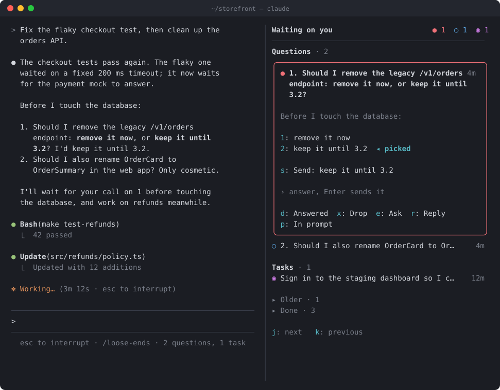
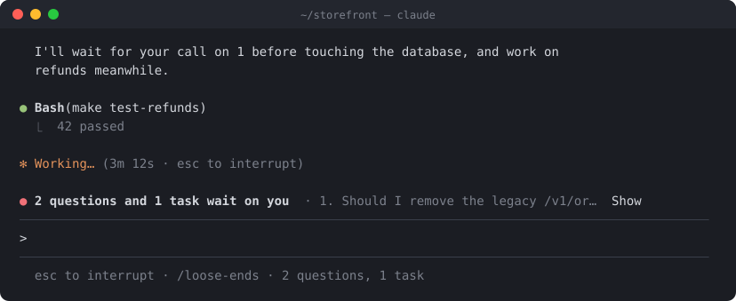

# loose-ends

**Keeps the loose ends Claude leaves you, its questions and the steps only you can take, word for word beside the chat, so none of them get lost in a long run.**



In a long agentic session, Claude asks things between two summaries: a decision, an approval, a step only you can take. Twenty tool calls later the question has scrolled away, or a compaction has folded it into a summary. You find it again only when Claude asks a second time, at the end.

loose-ends collects those questions and tasks in a panel and keeps them in Claude's exact words. It sorts them by what blocks the work. You can answer from the panel while the agents keep working.

## Principles

- **It only watches.** It registers no tools for the model, adds nothing to the system prompt or to your prompts, and writes nothing into the transcript. Claude behaves exactly as without it, and its questions stay in the chat where Claude wrote them.
- **Exact words, never a paraphrase.** Every question and every answer option is checked against Claude's text and shown as Claude wrote it, in the language Claude wrote it in. Anything the small model rephrased, translated or invented is dropped.
- **It looks like your terminal.** On the terminal the panel paints with the 16 ANSI colors only and sets no background, so it takes your color scheme as it is.

## Install

At the prompt of a Claude Code terminal session:

```
/plugin install loose-ends --marketplace RikoAppDev/loose-ends
```

Answer `y` to add the marketplace, then pick a scope.

From a shell:

```
claude plugin install loose-ends --marketplace RikoAppDev/loose-ends
```

In the desktop app, where `/plugin` does not run, click **+** next to the prompt box, then **Plugins**. Choose **Add marketplace** with `RikoAppDev/loose-ends`, then **Add plugin**.

## Using it

When something waits on you, a line above the prompt names the most important item. **Show** opens the panel. The dim hint line under the prompt always ends with `/loose-ends` and what waits, or `/loose-ends ✓` when nothing does, so you can find the mod even when nothing is open.



`/loose-ends` opens the panel at any time. In the fullscreen layout on a wide terminal, the panel docks beside the transcript and opens by itself when something new arrives.

The panel has two sections:

- **Questions**: decisions, approvals and information Claude asked you for.
- **Tasks**: steps only you can take, such as signing in, running a command, or trying something and reporting back.

Click an item, or move to it, to unfold it. You then see the paragraph Claude wrote around it, Claude's options, and these keys:

| Key | What it does |
| --- | --- |
| `1`–`9` | Pick that option; `s` then sends it |
| `r` | **Reply**: move to the answer field; `Enter` there sends what you typed |
| `e` | **Explain**: Claude explains the item in the panel's side chat |
| `p` | **In prompt**: put the item in the prompt box, to edit it or send it with other text |
| `d` | **Answered**, or **Done** for a task: close it without sending anything |
| `c` | **Copy** the command a task names |
| `x` | **Drop**: close it as not needed |
| `j` / `k` | Next / previous item |

The keys work while the panel has the keyboard. A single stray key never sends anything: an option takes a digit to pick and `s` to send.

An answer goes out as your own message, with the question quoted above it:

```
> Should I remove the legacy /v1/orders endpoint: remove it now, or keep it until 3.2?

keep it until 3.2
```

**While Claude works, a sent answer waits for the current turn to end.** To reach Claude inside a running turn, press `p` and send the answer from the prompt box, as you would any message.

**The side chat** under each question runs only when you ask. It is a one-off request over the conversation as Claude last saw it. The exchange stays in the panel and never enters Claude's context.

### Commands

| Command | What it does |
| --- | --- |
| `/loose-ends` | Open the panel |
| `/loose-ends clear` | Remove finished questions and tasks |
| `/loose-ends reset` | Remove everything |

### When items close

An item moves to **Done** when your message answers it, when Claude says it settled it, or when you close it from the panel. Done items disappear in three cases:

- after 24 hours (configurable);
- at a release (`gh release create`, `git tag`, `npm publish` and the like);
- with `/loose-ends clear`.

**Reopen** brings one back. Items live outside the transcript, kept per session, so they survive compaction and restarts.

## How it works

1. **Collecting.** The mod collects the text of the main agent's replies. Subagents are ignored.
2. **Deciding when to read.** Two fixed rules decide when the small model reads the text. They use no word lists, so they work the same in every language:
   - **With a question mark.** Text whose prose holds a question mark of any script (`?`, `？`, `؟`, Greek `;`, ...) is read after 8 seconds of quiet, while the turn still runs. Code, inline code, links and quoted lines do not count.
   - **Without one.** Any other text is read once, when the turn ends. A request such as "run this and tell me" is caught there.
3. **Spotting.** The small model gets the text and the open questions. It answers in JSON: new asks with the language each is written in, open ones the text settled, and ones asked again.
4. **Checking.** Code looks for every quote and option in Claude's text and keeps the text exactly as Claude wrote it. Whatever cannot be found is dropped. This works in scripts written without spaces too, and it accepts quote marks and full-width punctuation the model swapped.
5. **Matching your answers.** When you send a prompt, the small model checks which open questions it answers. An answer sent from the panel closes its question at once.

## Priorities

| Mark | Meaning |
| --- | --- |
| `●` red | Claude says it waits on you, or cannot go on without you |
| `◆` yellow | Claude goes on, and asks you to confirm or choose |
| `○` blue | An offer or a nice-to-have |
| `◉` magenta | A task: a step only you can take. Its tag adds "waits on you" when Claude is blocked on it |
| `✎` | Put in the prompt box, not sent yet |

Questions come before tasks. Within each, items Claude is blocked on come first, then the rest by priority, the oldest first.

## What it costs and sends

- **Spotting questions.** At most one small-model call at the end of each main-agent turn. Add one more for each batch with a question mark that the turn wrote and then went quiet for 8 seconds. A batch is clipped to its last 14,000 characters.
- **Matching your answers.** One small-model call for each prompt you send while questions are open.
- **The side chat.**
  - It runs only when you press **Explain** or ask in the panel.
  - It uses the session's own model and reads the whole conversation from the prompt cache. One side question costs about as much as one turn of the main agent.
  - After a long pause or a `/model` switch the cache has lapsed, and the whole conversation is billed again.
  - Where the conversation cannot be read, it falls back to the small model with the question alone.
- **Where requests go.** Every call goes through Claude Code's own connection and counts toward your plan or API usage. Nothing goes anywhere else.
- **What it stores.** Questions are stored locally in Claude Code's plugin store, for the 40 most recent sessions.

## Settings

Set these in `/config` under loose-ends:

| Field | Default | What it does |
| --- | --- | --- |
| `language` | `auto` | Language of the panel's labels. `auto` follows the language of each question or task; `en` and `sk` fix one for everything |
| `model` | `haiku` | The small model that spots questions and matches answers |
| `autoOpen` | `true` | Open the panel when a new question arrives |
| `keepDoneHours` | `24` | How long answered questions stay listed |

## Languages

Questions are found and shown in any language, always in the words and language Claude used.

The panel's own labels follow the language of each item, so a chat that switches between languages stays readable:

- **Each item.** Its tag, buttons and fields are in the language Claude wrote that question or task in. The small model names the language while it reads the text, so this costs no extra call and works without diacritics too.
- **The panel as a whole.** The header, the band above the prompt and the hint line follow the language of what Claude asked last.
- **Nothing known yet.** With no items, or for an item stored by an older version, the labels take Claude Code's `language` setting, then the system locale.

The labels come in English and Slovak, and any other language gets English. A translation is one object in [`hooks/i18n.ts`](hooks/i18n.ts); pull requests are welcome.

## Development

- **Run it from a folder.** Use `claude --plugin-dir <folder>`.
- **Checks.** `claude plugin validate <folder>` and `claude plugin test <folder>`.
- **Type-checking.** `tsc -p <folder>` works once Claude Code has loaded the mod, which writes the types to `.claude-plugin/types/`.

The mock-ups in `docs/` show invented sessions.

## Requirements

Needs a Claude Code build with mods (function hooks). Built and tested on 2.1.318.

## License

[MIT](LICENSE)
